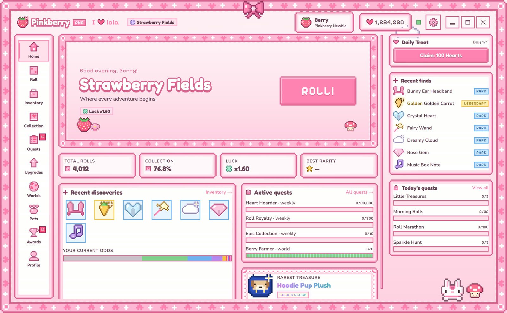

# Pinkberry RNG

A cute pixel-art collecting game for Windows. Roll for treasures, find rare ones, and collect them all.

**[Download the game](https://overhours.github.io/PinkBerry-RNG/)**

## Install

1. Download `Pinkberry-RNG-Setup.exe` from the [latest release](https://github.com/overhours/PinkBerry-RNG/releases/latest).
2. Run it and click Install.

If Windows shows “Windows protected your PC”, click **More info** → **Run anyway**. The game isn’t code-signed yet, which is why that box shows up. Each release lists the file’s SHA-256 so you can check your download with `Get-FileHash`.

You only install once. After that, the game updates itself from inside the app and keeps your save.

## Requirements

Windows 10 or 11, 64-bit.
